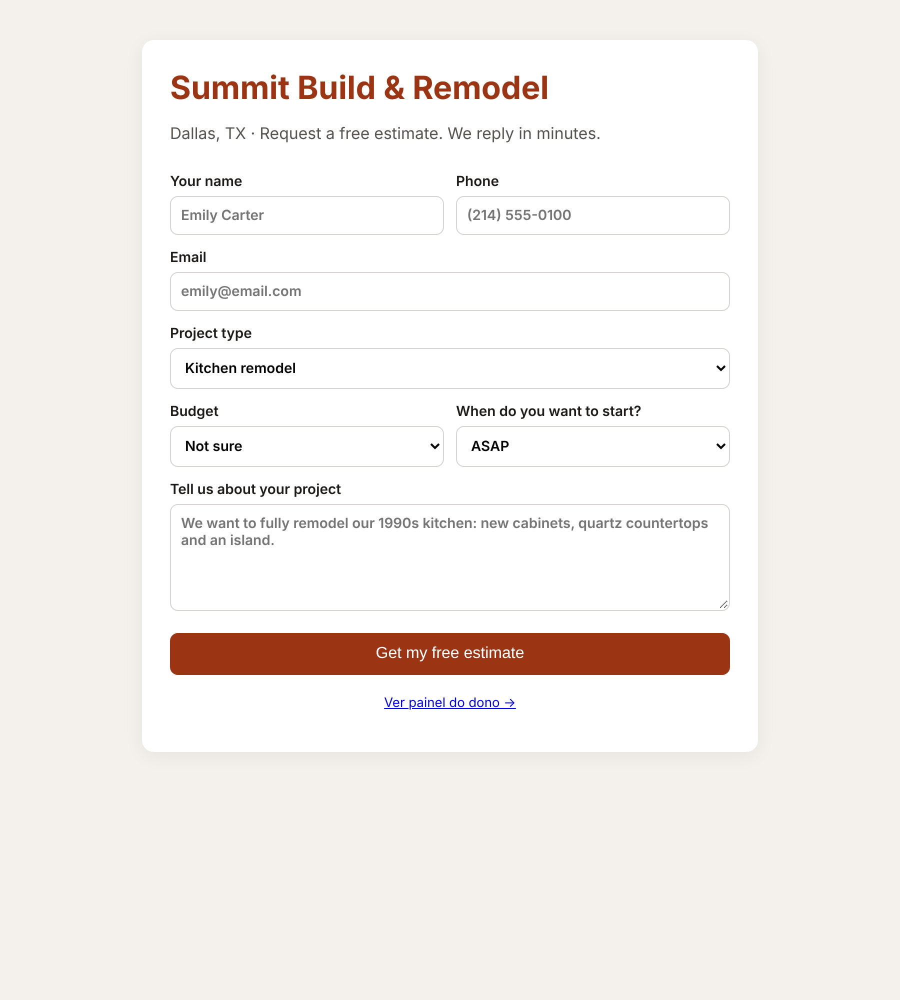
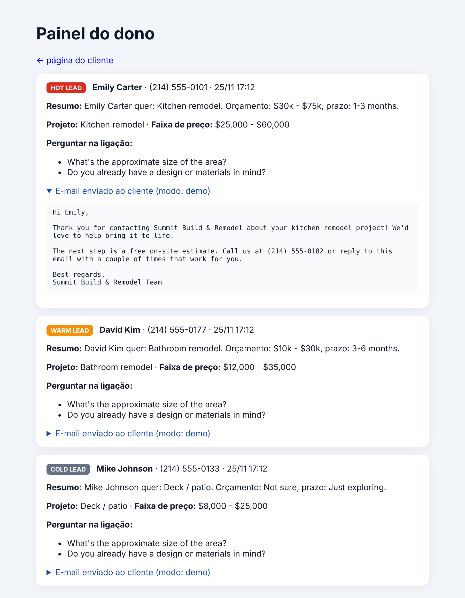

# AI Lead Responder for Contractors

**The contractor who replies first usually wins the job. Now you always reply first.**

An AI automation for remodelers, roofers and general contractors.
When a homeowner requests an estimate on your website, the AI instantly:

1. **Scores the lead**: HOT (ready to hire), WARM, or COLD (just browsing)
2. **Identifies the project** and a realistic local price range
3. **Replies to the homeowner within seconds** with a personalized, professional email
4. **Suggests the questions to ask** on the first call
5. **Shows everything on an owner dashboard**, hottest leads first

| Homeowner estimate form | Owner dashboard |
|---|---|
|  |  |

## Plans

| | Setup | Monthly |
|---|---|---|
| **Monthly plan** | $1,500 one-time setup | $199/month (hosting, AI usage, support) |
| **Annual plan** ⭐ | **Setup included** | $1,990/year (2 months free) |

🎁 **Annual plan bonus: a professional website for your business, built for free**
with your services, photos, reviews and contact info, with the AI estimate form already built in.

## How it works

```
Estimate form ──► app.py ──► ia.py ──► Claude (structured JSON output)
                    │                    lead score · project · price range
                    │                    summary · questions · reply email
                    ▼
              pedidos.json ──► /painel (owner dashboard)
```

The AI must fill in a fixed JSON schema instead of returning free text,
so the rest of the system always receives predictable, validated data.

## Run it

Requires Python 3.10+.

```bash
python3 app.py
```

Then open http://localhost:8000. Without an API key, the app runs in **demo mode**
(simple rules), so you can try it for free.

To use real AI:

```bash
pip install anthropic
export ANTHROPIC_API_KEY=your-key-here
python3 app.py
```

## Production version adds

- Real email replies (Gmail / SendGrid) and SMS alerts for HOT leads (Twilio)
- Automatic follow-up for estimates with no answer after 2 days
- Integration with the contractor's website, CRM or Google Sheets
