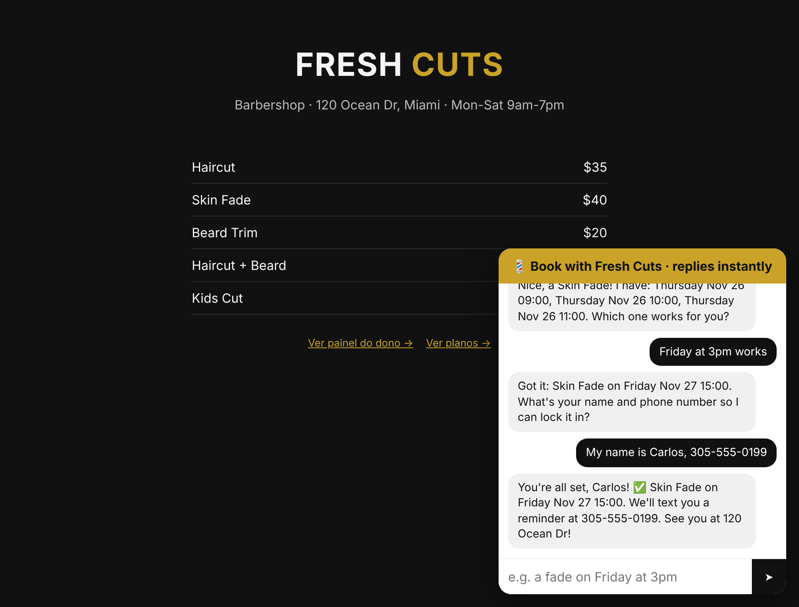
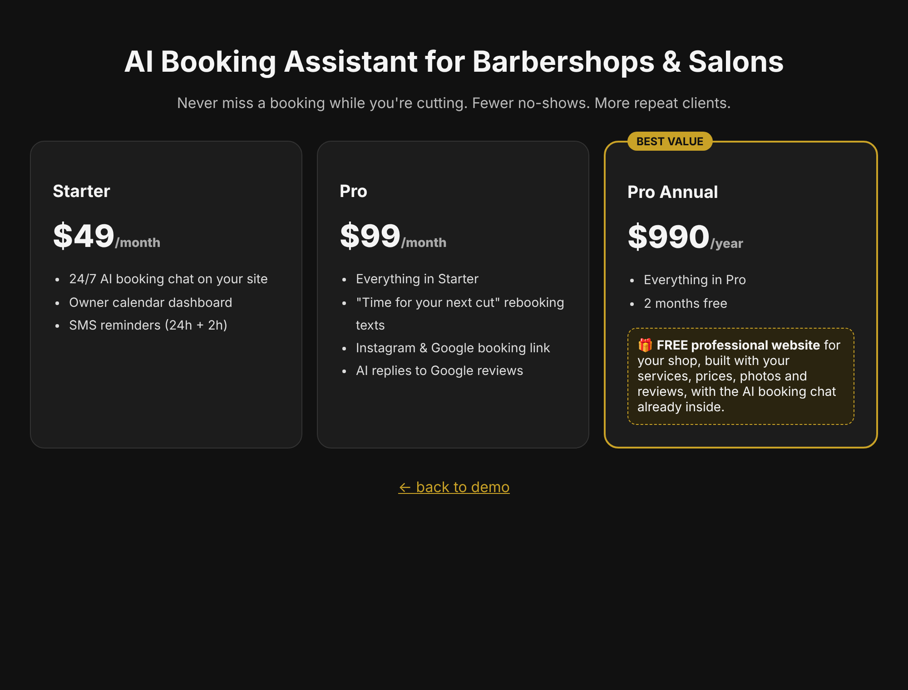

# AI Booking Assistant for Barbershops & Salons

**Never miss a booking while you're cutting. Fewer no-shows. More repeat clients.**

Barbers can't answer the phone with clippers in their hands. This AI assistant
chats with customers on the shop's website 24/7 and books them in, then follows up automatically:

- 💬 **Books appointments by chat**: understands "a fade on Friday at 3pm", offers open slots, collects name and phone
- 📅 **Owner calendar dashboard** with every booking and revenue
- ⏰ **Automatic SMS reminders** 24h and 2h before (fewer no-shows)
- 🔁 **"Time for your next cut?" texts** 4 weeks later (more repeat clients)
- 🛡️ **Never double-books**: the AI's answer is always checked against real availability

| Booking chat | Owner dashboard | Plans |
|---|---|---|
|  |  |  |

## Plans

| Plan | Price | Includes |
|---|---|---|
| Starter | $49/month | AI booking chat, owner dashboard, SMS reminders |
| Pro | $99/month | + rebooking texts, Instagram/Google booking link, AI review replies |
| **Pro Annual** ⭐ | **$990/year** | Everything in Pro, 2 months free, plus a **FREE professional website** for your shop |

🎁 **Annual plan bonus:** we build a professional website for your shop with your services,
prices, photos and reviews, with the AI booking chat already inside.

## How it works

```
Customer chat (site.html) ──► /chat ──► ia.py ──► Claude (structured JSON)
                                 │                  reply · service · slot · name · phone
                                 ▼
               slot really free? ──► agendamentos.json ──► /painel + scheduled reminders
```

## Run it

Requires Python 3.10+.

```bash
python3 app.py
```

Open http://localhost:8000 and chat with the assistant. Without an API key it runs in
**demo mode** (keyword rules), so you can try it for free.

To use real AI:

```bash
pip install anthropic
export ANTHROPIC_API_KEY=your-key-here
python3 app.py
```

## Production version adds

- Real SMS via Twilio and Google Calendar sync
- Multiple barbers with their own schedules
- Booking link for Instagram bio and Google Business Profile
